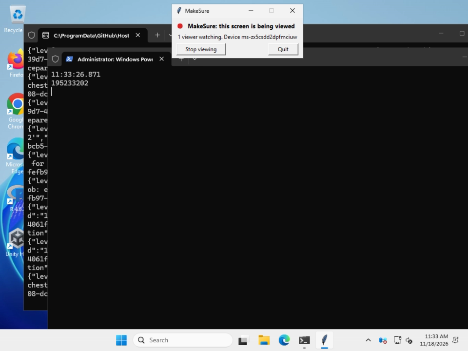

# Test results

All numbers below were measured on 2026-11-18. Nothing here is simulated.

## Setup of the end-to-end test

| Role | Where |
|---|---|
| Agent | `MakeSureAgent.exe` (PyInstaller single file, 54 MB, SHA-256 `9a17325d...60aef3`) on a GitHub Actions `windows-latest` runner: Windows Server 2025 Datacenter in Microsoft's cloud, behind NAT, no inbound ports |
| Relay | `python -m makesure.relay run` on a MacBook on a home network in the Netherlands, bound to `127.0.0.1` |
| Tunnel | Cloudflare quick tunnel (`trycloudflare.com`), started by the relay |
| Viewer | `tools/probe_viewer.py` on the MacBook, connecting through the public tunnel URL, decoding H.264 with PyAV |

The exe job has no checkout and no Python setup. It downloads only the exe, and before starting it
removes every Python directory from `PATH` and checks that `python` cannot be found
(GitHub run 44294274206). On screen, a PowerShell window printed the time every 100 ms so the picture kept changing.

Stream settings: defaults (H.264, 15 FPS, 1280x720 limit). The runner's screen is 1024x768, so the stream was 960x720.

The frame above was received on the Mac through the tunnel. It shows the Windows desktop and the
always-on-top indicator ("MakeSure: this screen is being viewed", 1 viewer, Stop viewing, Quit).

## Scenario checklist

| Step | Result |
|---|---|
| Start the agent on Windows | Pass. Exe started with no Python on `PATH`. |
| Outbound connection through the free tunnel | Pass. Connected and enrolled in about 7 s after launch. |
| Viewer on a different network | Pass. Agent in Microsoft's cloud, viewer on a home network. |
| See the live desktop | Pass. See frame above; 15 FPS. |
| No remote control | Pass by design and by test: the protocol has no such message, and `tests/test_safety.py` checks unknown messages are ignored and no input, subprocess or clipboard library is imported. |
| Disconnect and reconnect | Pass. Three viewer reconnects: first frame after 1.28 s, 0.74 s, 0.72 s. |
| Build with PyInstaller | Pass on the first attempt, single file. |
| Run the exe where Python is not available | Pass with a caveat, see "Not tested". |
| Full streaming test with the exe | Pass. All numbers in this file come from the exe. |

## Performance (Windows exe, through the tunnel)

| Measure | Steady 75 s | Steady 200 s |
|---|---|---|
| Frames received and decoded | 1120 / 1120 | 2982 / 2982 |
| FPS mean (lowest 1 s window) | 15.0 (14) | 14.9 (0, one 2.5 s network stall, then caught up) |
| Resolution | 960x720 | 960x720 |
| Bitrate mean | 690 kbps | 707 kbps |
| End-to-end latency mean / p50 / p95 | 144 / 138 / 180 ms | 186 / 142 / 237 ms |
| Sequence gaps (dropped frames) | 0 | 12 |
| Time to first frame | 0.43 s | 0.42 s |

Agent on the runner (both exe processes together):

| State | Working set | CPU |
|---|---|---|
| Connected, nobody watching | 82 MB at start, 35 MB later | About 0 (0.3 s of CPU in 2 minutes) |
| Streaming | 104 MB, flat over each streaming period | About 0.15 of one core |

Idle behaviour: the log shows capture starting only when a viewer connects ("streaming started")
and stopping when the last one leaves ("streaming stopped after N frames").

Adaptive quality: the log shows the bitrate target climbing from 1500 to the 4000 kbps ceiling
while the link was healthy. Stepping down under a constrained link is covered by unit tests only.

## Interruptions (Windows exe)

| Event | What happened |
|---|---|
| Outbound traffic of the exe blocked by a firewall rule for about 30 s | Stream stopped. Agent retried at 1, 1.2, 3.8, 5.5, 14.6, 26.4 s intervals and reconnected by itself. The viewer got pictures again 54 s after the cut, with no action on either side. The delay after the block ended came from the growing retry wait (limit `reconnect_max_s`, default 30). |
| Exe killed and started again without a token | Reconnected with its stored key. Viewer had pictures again after 9 s. |

## Same path with the Mac as agent

Earlier check of the transport alone: agent and viewer on the Mac, traffic through the Cloudflare tunnel.
15 FPS, 0 gaps, latency 55 ms mean, reconnects in 0.2 s. The web viewer was checked in a browser
against this stream: login, device list, Connect, live stats (15 FPS, 1108x720, 41 ms), Disconnect.
The Mac picture was a blank dark frame because the test process had no Screen Recording permission.

## Automated tests

- macOS: 106 passed.
- Windows runner: 105 passed, 1 skipped.

They cover the protocol, enrollment (bad, expired and reused tokens, wrong signature, revoked device),
login lockout, viewer socket without a cookie or with a wrong Origin, the device list needing a login,
no capture while idle, start and stop, two viewers at once, a slow viewer not stalling a fast one,
agent reconnect after a relay restart, and the no-control checks.

## Not tested

- A truly clean Windows installation. The runner image has Python installed; it was hidden from the exe,
  which is close but not the same. The `py` launcher in `C:\Windows` was still present (the exe does not use it).
- Windows 10 and Windows 11 desktop editions. The run was on Windows Server 2025.
- The web viewer in a browser against the Windows stream (the Windows stream was measured with the probe;
  the browser was checked against the Mac stream).
- Clicking "Stop viewing" and "Quit" by hand on Windows. The window is visible in the frame above; the logic is unit tested.
- Sessions longer than 10 minutes. Memory was flat over that time; hours-long stability is unproven.
- A slow or lossy link, and more than one device at a time.
- Lock screen, UAC prompts, fullscreen kiosk apps, high-DPI scaling.
- The ngrok provider and a Cloudflare named tunnel.
